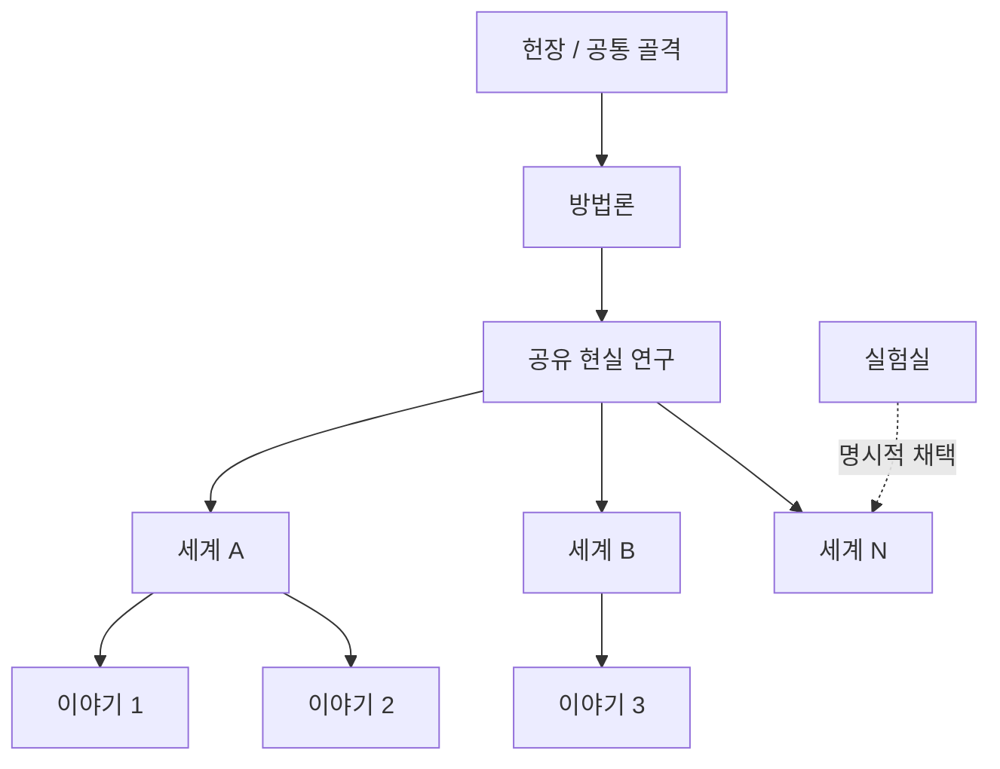

# 공통 설계 — 줄기

## 독립성

의존 방향은 공통 골격 → 연구 → 세계 → 이야기다. 이는 지식의 전달 방향이며 Git 브랜치의 강제 구조가 아니다. 세계와 이야기는 동시 작업할 수 있도록 디렉터리로 구분한다. 같은 main에 있어도 정설은 서로 독립적이다.

| 영역 | 무엇을 담나 | 무엇을 담지 않나 |
|---|---|---|
| core | 저자의 의도, 범위 경계 | 특정 세계의 설정 |
| methodology | 연구·분기·검증 도구 | 확정 미래 |
| research | 출처가 있는 현재/과거 관측, 추론과 불확실성 | 세계별 정설 |
| worlds/<id> | 독립 역사, 세계 변수, 제도와 일상 | 다른 세계의 무단 수정 |
| stories/<id> | 초안, 인물, 사건, 작품별 예외 | 공통 정설의 묵시적 수정 |
| lab | 시험적 설정, 모형, 폐기 가능한 아이디어 | 자동 확정되는 결과 |
| context | 상태, 중요한 결정, 세션 연결 | 대화 전문이나 개인 자료 |

공유 연구에서 세계가 채택한 근거는 가능한 경우 Git 커밋 또는 고정된 기록 ID로 참조한다. 중요한 가정은 세계 안에 요약해 둔다. 연구가 갱신되어도 기존 세계가 소급 변경되지 않는다. 이야기 역시 정설이 중요하면 해당 세계 버전을 고정한다. 분기된 대안은 새 세계 또는 이야기 안의 독립 실험으로 둔다.

다른 세계의 아이디어를 가져올 때에는 필요에 따라 출처 세계와 수정점을 기록한다. 공동 자료로 승격하는 것은 명시적 선택이며 특정 세계의 설정을 공통 연구에 사실로 넣지 않는다.

초기에는 Markdown과 Git 이력만 사용한다. 스키마 검증, CI, 생성기, 데이터베이스, 브랜치 보호, 강제 템플릿은 도입하지 않는다. 규모가 커져 실질적인 필요가 생길 때만 확장한다.
